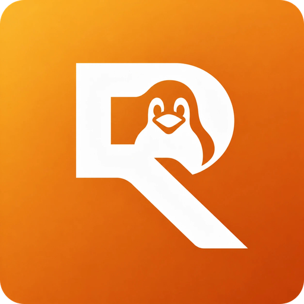
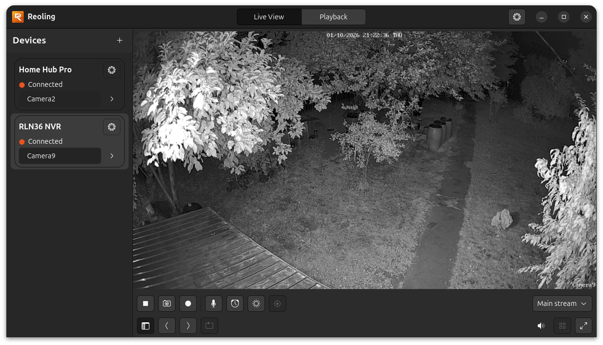
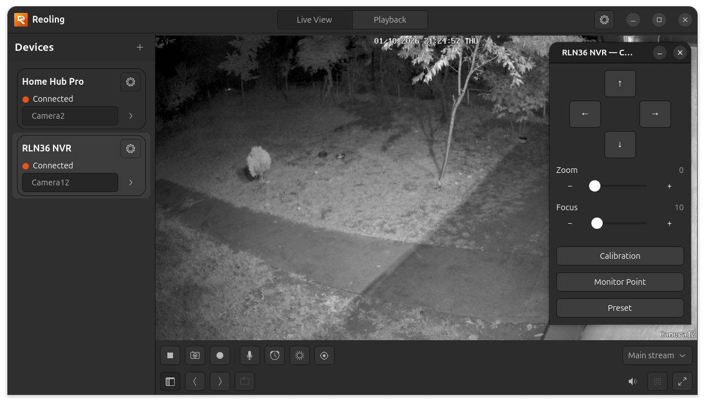
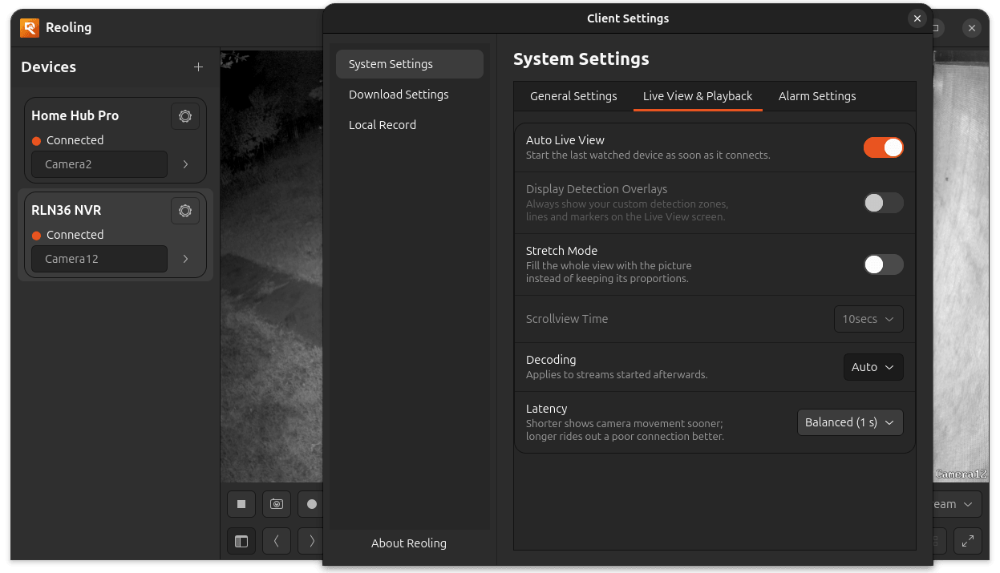
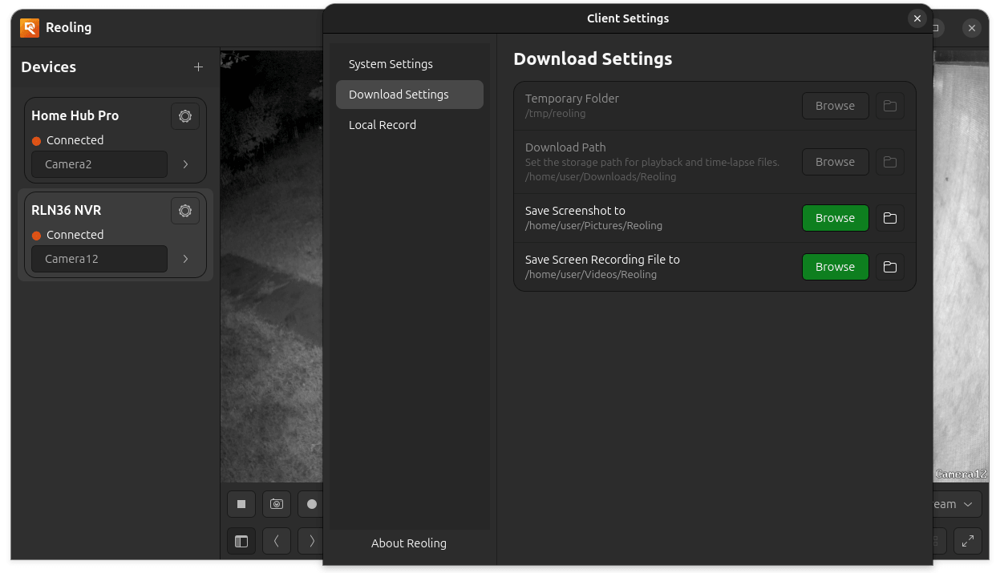

#  **Reoling**  

An unofficial client for Reolink® devices — cameras, NVRs, and Home Hubs —
that connects over Reolink's proprietary "Baichuan" P2P protocol using only
a device's UID (no manual IP/port configuration, no cloud account required).

**Website: <https://reoling.eu>**

Reoling is not affiliated with, endorsed by, or sponsored by Reolink.
"Reolink" is a trademark of its respective owner.

## Screenshots

<p align="center">
  
  
</p>
<p align="center">
  
  
</p>

More on <https://reoling.eu>.

## Status

Version **1.0.3**, with installable packages since 1.0.0 (see
[Installation](#installation)). Login, live video, PTZ, the camera and
device settings pages, and playback with sound, events and downloads
work end to end on a real Home Hub, NVR and their cameras, over UDP/P2P
only (local, NAT-mapped or relay address, whichever answers first).

**What the app does today**

- Devices: add by UID or IP; each connects at start, with its own name,
  channels and streams; one password per device, in the desktop keyring.
- Live view of a device or channel, the lightest stream first, Stop and
  Play, a latency setting; fullscreen controls hide after 2.5 s unused.
- Digital zoom in live view and playback: the wheel zooms at the pointer
  up to 16×, a left drag pans, a middle click shows the whole picture.
- Sound with a volume control, and Talk from the computer's microphone
  to the camera.
- Playback per camera: a month calendar, a day timeline to seek and zoom,
  speeds from 0.25× to 16×, main or sub stream, sound at 1×.
- Events: the camera's detections as bars on the timeline, a filter by
  type, and buttons to jump to the previous or next event.
- Downloads of a time range, up to 15 min or the whole recording, as an
  MP4 with sound; the device's live video and playback wait meanwhile.
- Camera controls, as each camera reports them: siren, spotlight, and a
  Camera control window for pan/tilt, zoom/focus and calibration.
- Monitor Point (a home position with Auto Return) and Preset Points,
  with pictures; go to, add, edit and delete the presets.
- Camera settings: main and sub stream Encoding (resolution, frame rate,
  bitrate, I-frame interval) can be changed; the other tabs are shown.
- Save and Revert on a Home Hub's cameras for a few Display, Image and
  Light & sound rows (E1 Outdoor PoE) and noise reduction (RLC-1224A).
- Device settings of a Home Hub or NVR, read-only: info, storage,
  network, time, sound or alerts, users and maintenance.
- Snapshot (PNG in `~/Pictures/Reoling`) and recording (MKV in
  `~/Videos/Reoling`, where downloads go too).
- Client Settings: run at startup, the theme (Auto, Light or Dark), Auto
  Live View, Stretch Mode, System Status, snapshot and recording folders.
- Decoding: Auto tries the integrated GPU first (or the dedicated one),
  then software; Hardware or Software can be set instead.

Each of these in full: [docs/FEATURES.md](docs/FEATURES.md).

**Not done yet**

- Changing settings beyond Encoding and the Home Hub camera rows above.
- Split View; the camera's own zoom behind an NVR's sub-channel numbering.
- Several cameras on one Playback page; thumbnails in the lists.
- One download at a time per device; no multi-camera or whole-day batch.
- Presets saved before 0.1.13 have no picture until one is taken in Edit.
- Talk is the least tested part; PTZ calibration has no "finished" signal.

**Version history**

- 1.0.3 — the .deb and the AppImage, built as 1.0.2's were. Fullscreen
  controls lie under the picture, as wide as it, so on an ultrawide
  monitor they no longer sit beside it. On X11 the windows' `WM_CLASS`
  is `de.dersobi.reoling`, as the desktop entries say, so a dock can
  show Reoling's icon. A connection that stays up for days skips the
  request numbers the device sends its own messages under. The .deb
  also installs docs/FEATURES.md, and both packages carry the GTK 4 sink
  stripped; Cargo.toml names Rust 1.88 as the minimum.

The full history, with the date of every version, is in
[CHANGELOG.md](CHANGELOG.md).

## How it works

Reoling implements the Baichuan protocol from scratch, in Rust, based on
observed wire behavior (see [Protocol](#protocol)). It needs no Reolink
cloud account and no other software — you connect directly to a device by
its UID, and Reoling resolves the P2P path itself.

A UDP receive task keeps draining the socket and acknowledging packets
independently of the video pipeline, and every video frame is pushed
straight into GStreamer from the network thread, so a busy GTK main loop
never affects playback. GStreamer's `decodebin` picks the decoder, in the
order the Decoding setting gives it: by default a hardware decoder on the
integrated GPU first, then one on a dedicated GPU, then software.

## Project layout

```text
src/
├── protocol/    Wire protocol only: binary framing, XML, BCEncrypt/AES.
│                No I/O, no async runtime — a pure, testable codec.
├── transport/   P2P/UDP: UID resolution, NAT traversal, relay fallback,
│                and the reliable BCUDP connection.
├── client.rs    Client/session API: login and live video;
│                `client/replay.rs`: recordings, events, playback and
│                downloads; `client/settings.rs`: the settings pages
│                and their writes.
├── talk.rs      ADPCM encoding for Talk.
├── ui/          GTK4 + GStreamer desktop app (main window, sidebar,
│                dialogs, settings, playback, downloads, video and audio).
└── main.rs      The `reoling` binary.
examples/        Small diagnostic tools (UID probe, media trace analysis).
data/            Icons and the desktop entry.
docs/            FEATURES.md (every feature) and the README's screenshots.
scripts/         Packaging: the GTK 4 sink build, the AppImage tools and
                 build, and a rehearsal of the release in a container.
```

Reoling is a Linux-only desktop application.

## Installation

Every release on GitHub — <https://github.com/derSobi/Reoling/releases> —
carries two packages for x86_64 Linux, both built on Ubuntu 24.04 LTS by
the release workflow (`.github/workflows/release.yml`) so that they run on
24.04 and everything newer:

- **`reoling_1.0.3-1_amd64.deb`** for Ubuntu 24.04 LTS or newer and
  Debian 13 or newer (and derivatives with at least those library
  versions): `sudo apt install ./reoling_1.0.3-1_amd64.deb`. apt
  installs the GTK 4 and GStreamer runtime with it — the base, good and
  bad plugin sets (parsers, muxers, the nvcodec and va hardware decoders),
  the libav software decoders and a PulseAudio, PipeWire or ALSA sink —
  and recommends a VA-API driver (`va-driver-all`, or the one for your
  GPU) for hardware decoding and a keyring (GNOME Keyring or KWallet) for
  the device passwords. Ubuntu 24.04 has no `gstreamer1.0-gtk4` package, so
  the .deb carries GStreamer's GTK 4 paintable sink itself, in
  `/usr/lib/reoling/gstreamer-1.0`, a directory `reoling` adds to its
  plugin registry when it starts. Reoling then appears in the
  applications menu; `reoling --version` prints the installed version.
- **`Reoling-1.0.3-x86_64.AppImage`** for any other distribution with
  glibc 2.39 and GLib 2.80 or newer (Ubuntu 24.04, Fedora 40, Debian 13
  and later): `chmod +x Reoling-1.0.3-x86_64.AppImage` and run it.
  The AppImage mounts itself with FUSE 2 (`libfuse2` or `libfuse2t64`);
  without it, `--appimage-extract-and-run` unpacks it to a
  temporary directory for that run, and `--appimage-extract` unpacks it
  for good. Inside are GTK 4, GStreamer with the parsers, muxers, decoders
  (libav in software; the nvcodec and va plugins for hardware) and sound
  sinks the app uses, its GTK 4 sink, librsvg and the icons it draws. It
  uses the system's GTK 4 and GStreamer instead where they are at least as
  new as its own (GTK 4.14, GStreamer 1.24), so it looks like the
  desktop's other applications with the desktop's own theme, and its
  bundled copies otherwise; a line on stderr says which
  (`reoling: GTK and GStreamer core: host` or `bundled`), and
  `REOLING_GTK_STACK=bundled` or `host` forces the choice. From the system
  it always takes glibc, GLib (whose GIO modules read the desktop's
  settings), Mesa (OpenGL/EGL) or the NVIDIA driver's GL, the core X11
  client libraries (`libX11`, `libX11-xcb`, `libxcb`) and
  `libwayland-client` (GTK links `libX11` and `libwayland-client`, and
  Reoling `libwayland-client` too, so a session needs them on X11 and on
  Wayland alike), fontconfig and the fonts, PulseAudio or PipeWire
  (`pipewire-pulse`) or ALSA for sound, `libva` (the FFmpeg
  libraries behind the software decoders need it too, with `libva-drm` and
  `libva-x11`; any of them the system lacks comes from the AppImage), the
  hardware decoding driver — NVIDIA's `libcuda`/`libnvcuvid` for NVDEC, or
  a VA-API driver for the system's `libva` — and a Secret Service keyring
  (GNOME Keyring, KWallet) for the device passwords. It follows the
  desktop's GTK theme (and with it the accent colour); on the bundled GTK,
  a theme written for a newer GTK may print a few "Theme parser error"
  lines and lose some of its looks. It keeps its own GStreamer registry
  under `~/.cache/reoling`. The first
  time it runs it also gives its own file the Reoling icon in GNOME Files,
  which otherwise shows the bare "executable" icon for an AppImage: it
  copies the Reoling icon into your icon theme (under
  `~/.local/share/icons/hicolor`, for the sizes the system theme lacks)
  and sets it as the file's custom icon — the GIO attribute
  `metadata::custom-icon`, which Files shows at every zoom level and gvfs
  keeps per user and per path; by hand that is
  `gio set <file> metadata::custom-icon file://<icon>`. It also writes the
  file's thumbnail-cache entries under `~/.cache/thumbnails` for the file
  managers and dialogs that read the cache but no custom icon. Both are
  checked at every start, so a replaced file (a new download) or a moved
  one gets its icon back the next time it runs. Other file managers
  (Dolphin among them) may still show the generic icon. Where the .deb is
  not installed, it also writes the per-user desktop entry
  `~/.local/share/applications/de.dersobi.reoling.desktop`, which starts
  the AppImage file: Reoling then appears in the applications menu and the
  dock shows its icon. The entry names the copy started last (a source
  build writes the same entry for itself), and the menu hides it once that
  file is gone. A per-user entry hides the .deb's of the same name, so
  once the .deb is installed, the next start of either package (the menu
  still starts the AppImage until then) removes the entry Reoling wrote,
  and the .deb's takes over. If the AppImage file is deleted before that,
  Reoling is missing from the menu until `reoling` is started once from a
  terminal. That is all it touches, and only for the AppImage file it was
  started from: it installs no thumbnailer and no file type association,
  so nothing of Reoling's runs on other files.

Both packages decode video in hardware where they can: NVDEC
(`nvh264dec`/`nvh265dec`) on an NVIDIA GPU, VA-API (`vah264dec`/
`vah265dec`) on an Intel or AMD one. With Decoding set to Auto (integrated
GPU first), the default, Reoling orders the hardware decoders itself:
those on the integrated GPU first, then those on a GPU whose kind it
cannot tell, then those on a dedicated card, all of them ahead of the
libav software decoders, which take over where no driver is present. Auto
(dedicated GPU first) tries the card first. A GPU counts as dedicated when
switcheroo-control tags it so, or when it is an Intel or NVIDIA GPU behind
a PCI bridge; an Intel GPU at 00:02.0 on the root bus is the integrated
one, and any other GPU is of unknown kind. Settings → Live View &
Playback → Decoding switches to Hardware (with a choice of device when
there are several) or Software; System Status lists the hardware decoders
found (with the kind of GPU, where known), the decoding mode in use and
the decoders the latest live and recorded streams started with. Hardware
on a machine without a usable hardware decoder decodes in software
instead of leaving the picture black, and the Decoding row says so.

The workflow installs the .deb and starts both packages (`--version`, then
20 s on a virtual display) on Ubuntu 24.04, the AppImage there on either
GTK, and the AppImage again in Ubuntu 26.04 and 24.04 containers
(`scripts/smoke-appimage-in-docker.sh`) before it uploads them. To build
them yourself — the sink build needs Rust 1.92 or newer, and
`scripts/validate-in-docker.sh --host <output directory>` rehearses the
whole release in an `ubuntu:24.04` container and runs the container tests:

```bash
scripts/build-gst-gtk4-plugin.sh target/gst-gtk4   # the GTK 4 sink, where the distribution has none
cargo install cargo-deb && cargo deb                # target/debian/reoling_1.0.3-1_amd64.deb
scripts/fetch-appimage-tools.sh ~/appimage-tools    # linuxdeploy, its plugins, appimagetool (pinned)
APPIMAGE_TOOLS=~/appimage-tools scripts/build-appimage.sh target/release/reoling dist
```

## Building from source

Requires:

- Rust 1.88+ (edition 2021; required by the locked dependencies)
- GTK4 (`>= 4.6`, Ubuntu 22.04's baseline) with its Wayland backend, and
  its development headers
- `libwayland-client` 1.20 or newer and its development headers
  (`libwayland-dev`, which `libgtk-4-dev` pulls in)
- GStreamer, including `gstreamer-app`, the GTK4 paintable sink
  (`gstreamer1.0-gtk4`, or `scripts/build-gst-gtk4-plugin.sh`, which needs
  Rust 1.92 or newer, where the distribution has none) and a decoder
  plugin (`gstreamer1.0-libav` for software decoding; the nvcodec and va
  plugins from `gstreamer1.0-plugins-bad` for NVIDIA and VA-API hardware
  decoding)

```bash
cargo build --release
cargo run --release
```

Add a device with the **+** in the device list (its UID, or IP and port),
then log in with the device's username and password.

To run the full test suite (protocol codec, transport and session logic —
no real hardware required):

```bash
cargo test
```

The video zoom rendering test needs a display and runs separately. The
release workflow and Docker validation run it under Xvfb:

```bash
cargo test --bin reoling ui::zoom_picture::tests::widget_renders_and_resets -- --ignored --exact
```

## License

AGPL-3.0-or-later — see [LICENSE](LICENSE) for the full text and
third-party component notices (GTK4, GStreamer, and the Rust crates
Reoling depends on).

## Protocol

Reoling's Baichuan implementation is checked against packet captures of the
project's own devices and against probes run on them. Third-party licenses
are in [LICENSE](LICENSE).
