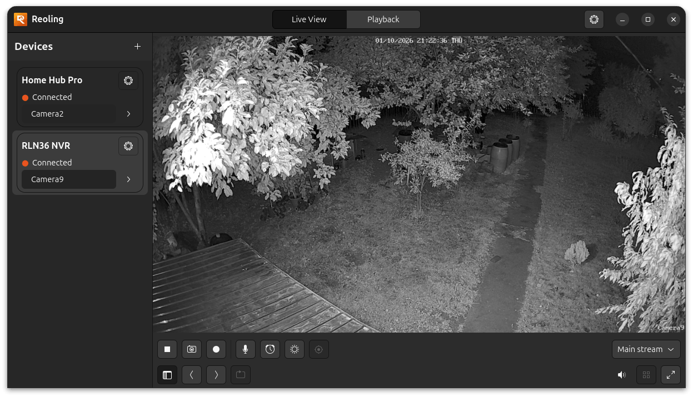
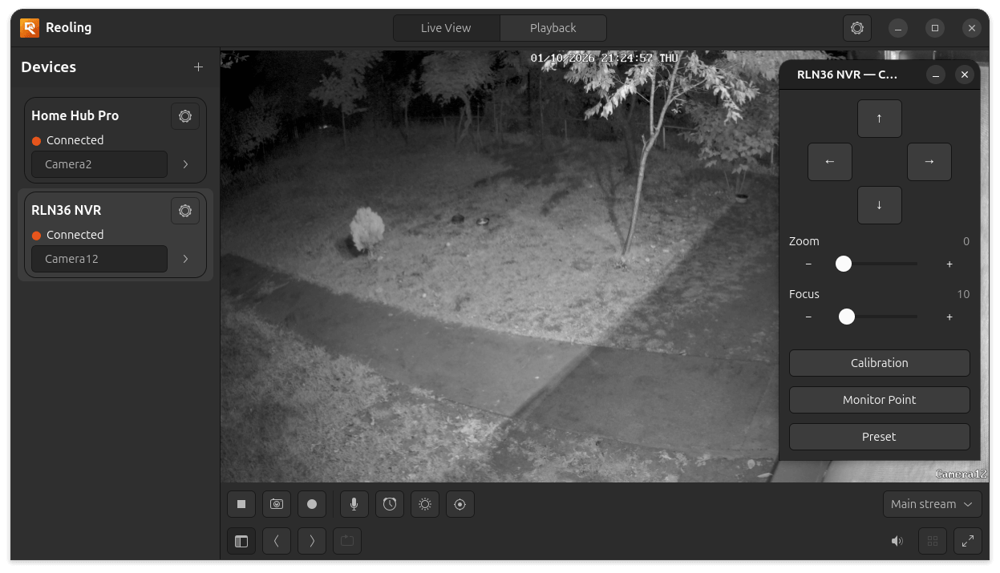
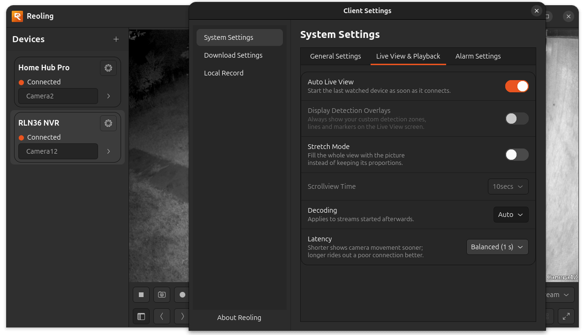
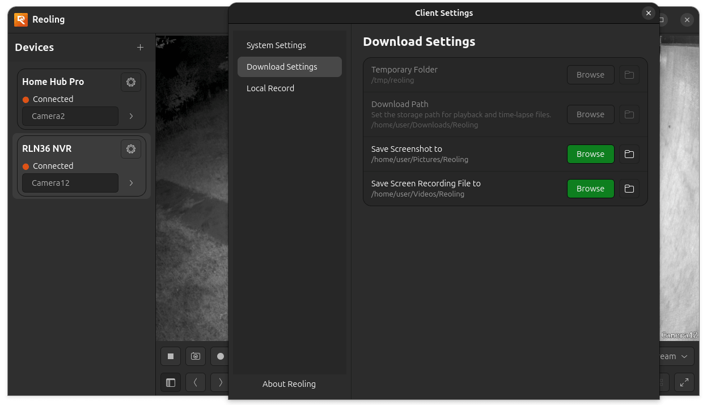

#  **Reoling**  

An unofficial client for Reolink® devices — cameras, NVRs, and Home Hubs —
that connects over Reolink's proprietary "Baichuan" P2P protocol using only
a device's UID (no manual IP/port configuration, no cloud account required).

**Website: <https://reoling.eu>**

Reoling is not affiliated with, endorsed by, or sponsored by Reolink.
"Reolink" is a trademark of its respective owner.

## Screenshots

<p align="center">
  
  
</p>
<p align="center">
  
  
</p>

More on <https://reoling.eu>.

## Status

Version **1.0.1**, the first release with installable packages (see
[Installation](#installation)). Login, live video, PTZ and the camera
controls, the camera and device settings pages, and playback with sound,
event bars and downloads work end to end on real hardware — a Home Hub,
an NVR and their cameras — over UDP/P2P only: Reoling races the device's
local, NAT-mapped and relay addresses at the same time and uses whichever
answers first.

**What the app does today**

- Devices: add by UID or IP; every saved device connects at start and shows
  *Connected* / *Not connected*; one password per device, kept in the desktop
  keyring; the device's own name, channels (with their names) and the streams
  each channel offers (main / extern / sub) are read from the device.
- Live view: click a device or one of its channels; the lightest stream is
  the default; Stop freezes the picture and becomes Play; the last stream
  restarts on the next start; fullscreen with a control bar that slides in;
  a latency setting (Low / Balanced / Smooth) trades reaction time for
  smoothness over a poor connection.
- Sound: the stream's audio with a volume control; Talk (microphone to the
  camera, ADPCM).
- Playback (the tab beside Live View): recorded video per camera of a Home
  Hub or NVR, or of a camera added on its own, picked in the sidebar. A
  month calendar marks the days with recordings; the day timeline shows
  them as bands and seeks with a click or the arrow keys (10 s, 60 s with
  Shift), zooms with the wheel or `+`/`-` (Home shows the whole day again)
  and pans with a drag. Play/pause, speeds from 0.25× to 16×, main or sub
  stream, and playback goes on into the next recording by itself. At 1×
  the recording's sound plays in sync with the picture, at the volume set
  for live view; the other speeds are silent. The camera's detections
  are drawn as event bars over the recordings on the day timeline (the
  tooltip names them), a detection filter narrows them to any motion,
  person, vehicle, animal, package or line crossing / zone, and
  previous/next-event buttons jump between them. It runs over the same
  UDP P2P connection as live video, which pauses while the tab is open
  and comes back as it was. A Download button saves a chosen time range —
  a start, a length from 30 s to 15 min or the whole recording, main or
  sub stream — as an MP4 with the recording's sound into the recordings
  folder (another folder can be picked there and is remembered); a range
  that crosses into the next recording comes out as one file. The file is
  named after the device, camera, start and length, its range is marked
  on the timeline, and progress shows under the controls with Cancel and
  "Open folder"; the download runs on if the page moves to another day or
  device. While a device downloads, its playback and live video wait.
- Camera controls, shown per channel from what the camera reports: siren,
  spotlight, and — in a separate "Camera control" window, independent of the
  main window — pan/tilt (hold a direction to move) and zoom/focus on its
  main page (read back from the camera after every change, since zooming
  makes it autofocus); Monitor Point and Preset Points are their own pages,
  reached from there and left with "back", the same drill-down the official
  app uses. Monitor Point: a saved home position with its own thumbnail
  (click it to refresh — a point saved from Reoling has none until this is
  pressed once), Auto Return on/off and its timeout in 1-second steps,
  "Return to Monitor Point", "Reset Monitor Point" to save the current
  position. Presets: laid out like the official app's Preset Points — a
  thumbnail card per preset (or a plain list, via the toggle), a click
  anywhere on it moves the camera there, Edit (name and picture; click the
  picture to refresh it) and Delete beside it, "refresh all" and "add" on
  top. Every opening of the page re-reads all pictures from the camera,
  one at a time (it breaks on overlapping image requests). Calibration
  disables the panel with a spinner while it
  runs — all confirmed working against real hardware.
- Camera settings (the gear button beside Camera control): the camera's
  product picture, model and firmware, and its video encoding per stream.
  Clear (main) and Fluent (sub) can be changed: resolution, frame rate,
  bitrate and I-frame interval, offered only as the camera itself allows;
  the live picture restarts with the new settings. Balanced (extern) is
  shown as it is. Beside Encoding, read-only tabs show what else the
  camera tells about itself, with the values as the camera reports them:
  Info (model, firmware, UID), Image (brightness, contrast, saturation,
  sharpness, hue, corridor mode, day and night switching, the advanced
  picture settings), Display (date, time and camera name on the picture,
  the watermark), Detection (motion sensitivity and alarm delay, smart
  detection types and object sizes, auto tracking), Light & sound
  (status LED, infrared lights, the spotlight and its schedule, siren
  triggers, sound), Schedules (the weekly recording, email, push, FTP
  and siren schedules, drawn as grids) and Network (address mode, IP,
  mask, gateway, MAC, DNS). Rows a model does not have — binning, auto
  tracking, a status LED, "Pet" instead of "Animal" — are left out, as
  the camera's own ability table says. Reload reads a tab again; the
  tabs are read while the camera's live video runs (press Play first if
  it is stopped) and wait while a download holds the connection. Product
  pictures come from Reolink's own site and are cached; until one loads,
  or for a model without one, a drawing of the device kind (camera, NVR,
  Home Hub) stands in.
- Device settings ("Device settings…" in the card menu of a connected Home
  Hub or NVR): the device's own window, read-only, one tab each. Info
  (model, firmware, UID), Storage (each drive's size and fill level, what
  happens when it is full, recording encryption), Network (address, the
  service ports — HTTP, HTTPS, RTSP, RTMP, ONVIF, UPnP —, DDNS, NTP and,
  on a Hub, the Wi-Fi it offers its cameras), Time (time zone, clock,
  date and time format, daylight saving, NTP), Light & sound on a Hub
  (status LED, notification and alarm volume, alarm pause) or Alerts on
  an NVR (recording, email, push and buzzer per camera), Users (the
  accounts, shared access, login lockout) and Maintenance (auto reboot).
  A tab is read when it is first shown and again on Reload; while a
  download holds the connection it says so and reads once that is over.
- Snapshot (PNG in `~/Pictures/Reoling`) and recording (MKV in
  `~/Videos/Reoling`, where Playback's downloads go too).
- Settings ("Client Settings", laid out after the official app's window):
  System Settings (General, Live View & Playback, Alarm), Download Settings,
  Local Record and About. Working: Run at Startup (an XDG autostart entry),
  Theme, System Status (versions and hardware decoders), Auto Live View,
  Stretch Mode, decoding (Auto / Hardware — with the decoder to use if there
  are several — / Software), latency, and the folders for screenshots and
  recordings. The official app's rows Reoling cannot act on yet (client
  update, add devices automatically, lockscreen password, date format,
  language, detection overlays, scrollview time, alarm beep, temporary and
  download folders, local record) are shown greyed out. Colours are the
  active theme's.

**Not done yet**

- Changing the settings on the new pages: only Encoding is editable; the
  camera and device pages are read-only.
- Playback of several cameras at once (one camera per page today), and
  thumbnails: the device list and the recordings show names and times,
  no pictures.
- Split View, zoom on cameras behind an NVR's sub-channel numbering.
- Playback: one download at a time per device, and the device's playback
  and live video wait while it runs; no download of several cameras or of
  a whole day at once.
- PTZ calibration has no separate "finished" signal from the camera — the
  app only knows the request was accepted, matching what's documented for
  Baichuan generally, not a limitation specific to this capture.
- Deleting a PTZ preset sends `delPos` (this project's best guess when it
  was first written, matched only against message counts in a capture; now
  confirmed working against a real camera).
- Talk has been built from the official app's captured messages but is the
  least tested part.
- Presets saved by an older Reoling (before 0.1.13) have no picture until
  one is taken in their Edit dialog.

**Version history**

- 1.0.1 — the first published packages: `reoling_1.0.1-1_amd64.deb` for
  Ubuntu 24.04 LTS and later (Debian 13 and later too) and
  `Reoling-1.0.1-x86_64.AppImage` for other distributions, both built on
  Ubuntu 24.04 by the release workflow and attached to the release on
  GitHub (see [Installation](#installation)).
  - Decoding: the hardware decoder — NVDEC or VA-API — is picked
    automatically, with the software decoders as the fallback. Hardware,
    set on a machine without a usable hardware decoder, now decodes in
    software instead of leaving the picture black; the setting is shown
    as it is stored, the Decoding row says that no hardware decoder was
    found, and System Status names the mode in use.
  - AppImage: it follows the desktop's theme and accent colour (the 1.0.0
    build forced its own theme, which coloured the connection dot blue),
    bundles the NVIDIA and VA-API GStreamer plugins for hardware decoding,
    and takes GLib and libva from the system, so the desktop's settings
    are read and the VA-API driver matches its library.
- 1.0.0 — the first release built as packages: `reoling_1.0.0-1_amd64.deb`
  for Ubuntu 24.04 LTS and later (Debian 13 and later too) and
  `Reoling-1.0.0-x86_64.AppImage` for other distributions, both built on
  Ubuntu 24.04 by a GitHub Actions workflow (they were not published: the
  AppImage had the faults 1.0.1 fixes); `reoling --version` prints the
  version.
  - Settings pages, read-only, with the values as the device reports
    them: the camera settings window gets Info, Image, Display,
    Detection, Light & sound, Schedules and Network tabs beside Encoding,
    and "Device settings…" in a Home Hub's or NVR's card menu opens the
    device's own window — Info, Storage, Network, Time, Light & sound
    (Hub) or Alerts (NVR), Users, Maintenance. Rows a model does not have
    are left out, after the camera's own ability table. Only Encoding can
    be changed.
  - Playback downloads: a range whose first recording is silent still
    gets the sound of a later recording it covers; two downloads started
    together never write into one file; a download the device does not
    answer in time is ended on the device and the connection stays
    usable; when the disk cannot keep up, the download fails instead of
    holding the recording in memory; and a damaged frame header in
    recorded footage no longer makes playback or a download wait (and
    grow in memory) for a frame that never completes — the stream resyncs
    at the next frame.
  - Requests that arrive while a download holds the connection, the
    settings reads among them, wait and go out once it is over.
- 0.1.27 — Playback: a Download button saves a chosen time range (a start,
  a length from 30 s to 15 min or the whole recording, main or sub stream)
  as an MP4 with the recording's sound into the recordings folder, as one
  file when the range crosses into the next recording; progress under the
  controls, Cancel, "Open folder", and the range marked on the timeline.
  A folder picked in the dialog is remembered as the recordings folder.
- 0.1.26 — Playback: sound, at 1× and in sync with the picture (the other
  speeds are silent); the camera's detections as event bars on the day
  timeline, a detection filter (any motion, person, vehicle, animal,
  package, line crossing / zone) and previous/next-event buttons to jump
  between them.
- 0.1.25 — Playback: recorded video per camera of a Home Hub or NVR (or of
  a camera on its own), over the same UDP P2P connection as live video. A
  calendar marks the days with recordings; the day timeline seeks, zooms
  and pans with the mouse or the keyboard; play/pause, speeds from 0.25×
  to 16×, main or sub stream, and it goes on into the next recording.
  Playback has no sound yet.
- 0.1.24 — Camera settings: a malformed encoding reply from a device can no
  longer crash the app, and an implausible I-frame range is not offered.
- 0.1.23 — Camera settings: the camera's picture, model and firmware, and
  its encoding per stream (resolution, frame rate, bitrate, I-frame
  interval), changeable within the values the camera allows — for example
  raising the sub stream from 10 to 15 fps.
- 0.1.22 — live video and camera control:
  - Pan/tilt keeps moving for as long as an arrow is held. A GTK timer used
    to send a stop about 0.4 s into every hold, so the camera moved in
    bursts.
  - The picture stays at the chosen latency. Before, a burst or a network
    hiccup added delay that never went away (measured: 2.6 s instead of 1 s
    on Balanced).
  - Sub and extern streams show every frame. On sub only about 1 frame in
    10 reached the screen: frames the decoder released late were discarded
    on the way to the display. Low frame rates are also paced evenly now.
  - Switching streams no longer fails with "unsupported bcmedia magic" when
    the end of the previous stream is still arriving.
  - A locked or busy device (too many users, device occupied…) now says so
    instead of "Incorrect password", and the saved password is kept.
  - The P2P servers asked about a UID are now the same set the official
    client uses.
  - New debug switches: `REOLING_DEBUG_LATENCY`, `REOLING_DEBUG_PTZ`,
    `REOLING_DUMP_VIDEO`, and `examples/replay_dump.rs` to replay a dump.
- 0.1.21 — the Download Settings screenshot is replaced by one without the
  background behind the window.
- 0.1.20 — the official website, <https://reoling.eu>, is linked from the
  README (with its screenshots, now kept in `docs/screenshots`), the About
  window and the package metadata.
- 0.1.19 — System Status: the text no longer takes the focus (it opened with
  everything selected); the Confirm button has it instead.
- 0.1.18 — the dock shows "Reoling" with its icon when run from a source
  checkout (a per-user desktop entry is written at start unless the system
  has one; `data/de.dersobi.reoling.desktop` is the one to install);
  settings window taller (no scrolling); System Status no longer opens with
  its text selected; "Support the project" points to GitHub Sponsors.
- 0.1.17 — the settings window is rebuilt after the official app's
  (sidebar with System / Download / Local Record / About, tabs under System
  Settings); new working settings: Run at Startup, Auto Live View, Stretch
  Mode, and where screenshots and recordings are saved; System Status and
  About windows.
- 0.1.16 — presets are listed in the camera's own order again (an id sort and
  a locally remembered order were tried and dropped).
- 0.1.14 — "New Preset Point" now takes the camera's current picture as it
  opens (click it to retake) and Confirm saves the preset with that picture,
  which shows in the list at once.
- 0.1.13 — Add and Edit now do what the official app does, from a decrypted
  capture of it: Add takes a live picture (`Snap`, 109), shrinks it to
  169×95, uploads it (420) and saves the preset at the current position with
  it; clicking the picture in Edit takes a new one the same way; Confirm
  renames (a preset message with no `command`) and attaches the new picture.
  Uploads go out with the JPEG in the clear, like Talk.
- 0.1.12 — `REOLING_DEBUG_PRESETS=1` prints the preset-picture queue's steps
  (to chase a "refresh all" that did nothing on real hardware).
- 0.1.11 — Preset Points redesigned after the official app's screenshots
  (thumbnail/list toggle, refresh all, add, Edit dialog, whole-card click
  moves the camera); pictures re-read one at a time on every opening; the
  local thumbnail cache from 0.1.10 is gone again (the official app does not
  keep one either); narrower remote window. Renaming a preset is not wired
  yet — the wire message for it is unconfirmed.
- 0.1.10 — Monitor Point's and every preset's thumbnail is now cached
  locally (`~/.cache/reoling/thumbnails`) and shown immediately from there
  on the next start or page open, instead of staying blank until the
  camera answers.
- 0.1.9 — found the real root cause with a second capture (Monitor Point
  worked fine twice, but asking for a *preset that never got a thumbnail*
  — e.g. one Reoling itself saved — always broke the connection, even as
  a single, fully-serialized request): the camera's "no file by that
  name" reply for that case declares a 0-byte body but still puts 4 extra
  bytes on the wire that its own header doesn't account for, desyncing
  every message read after it. The wire parser (`read_bc`) now recognizes
  and skips those bytes, with a unit test pinning the exact captured byte
  pattern; the 0.1.8 fix (refuse an overlapping image request) stays too,
  since it's real and correct on its own, just wasn't what was disconnecting here.
- 0.1.8 — the 0.1.7 fix wasn't the whole story: a real capture (Monitor
  Point refresh clicked twice, then Preset Points opened) showed the
  camera stays confused by a 4th image-file request sent before the
  earlier ones had each fully finished — even back-to-back, not truly
  concurrent — replying with a malformed header that desynced the
  connection. The client now refuses a new image request outright while
  one is still outstanding (for Monitor Point or any preset), with a 10s
  safety timeout in case the camera never replies at all.
- 0.1.7 — fixed a real-hardware bug where opening Preset Points
  disconnected the camera (`bad magic header`): it was fetching every
  preset's thumbnail at once, which the camera's image-file transfer
  can't handle concurrently; each preset's thumbnail is now click-to-
  refresh instead, matching Monitor Point's own thumbnail and the
  official app's own preset list (confirmed this only shows a picture
  after a manual refresh).
- 0.1.6 — Preset Points now show a thumbnail per preset, same as Monitor
  Point, fetched from the camera under each preset's own name
  (`preset_{id}`, confirmed from a capture of the official app's own
  preset list) each time the Preset Points page opens.
- 0.1.5 — the remote is now paged (Calibration/Monitor Point/Preset Points
  reached from the main page and left with "back"), matching the official
  app's own panel instead of showing everything at once — much shorter;
  Monitor Point's thumbnail is now click-to-refresh; calibration disables
  the panel with a spinner while it runs, with a 20 s safety fallback in
  case the camera's reply never arrives.
- 0.1.4 — Monitor Point's saved thumbnail, shown in the remote; its timeout
  now steps by exactly 1 second; calibration and Monitor Point confirmed
  working on real hardware; control-reply messages (e.g. Monitor Point
  actions were showing "Spotlight command sent") fixed to name the right
  command.
- 0.1.3 — PTZ Monitor Point (Auto Return, timeout, return, reset) and
  calibration, read from a capture decrypted with a local, standalone tool
  (see `examples/decrypt_bc_stream.rs`) against
  `.plans/reolink-baichuan-calibration-monitor-point.md`'s research.
- 0.1.2 — camera remote in its own window: zoom, focus (both read back after
  a change), PTZ presets (save / go to / delete); a latency setting.
- 0.1.1 — camera controls (siren, spotlight, pan/tilt, talk), snapshot,
  recording, audio, settings, per-channel streams, stop/play, fullscreen bar.
- 0.1.0 — protocol, P2P discovery, login, live video, first UI.

## How it works

Reoling implements the Baichuan protocol from scratch, in Rust, based on
observed wire behavior (see [Acknowledgments](#acknowledgments)). It never
requires the official Reolink cloud account or app — you connect directly
to a device by its UID, and Reoling resolves the P2P path itself.

A UDP receive task keeps draining the socket and acknowledging packets
independently of the video pipeline, and every video frame is pushed
straight into GStreamer from the network thread, so a busy GTK main loop
never affects playback. GStreamer's `decodebin` picks the best available
decoder (hardware or software).

## Project layout

```text
src/
├── protocol/    Wire protocol only: binary framing, XML, BCEncrypt/AES.
│                No I/O, no async runtime — a pure, testable codec.
├── transport/   P2P/UDP: UID resolution, NAT traversal, relay fallback,
│                and the reliable BCUDP connection.
├── client.rs    Client/session API: login and live video;
│                `client/replay.rs`: recordings, events, playback and
│                downloads; `client/settings.rs`: the settings pages.
├── talk.rs      ADPCM encoding for Talk.
├── ui/          GTK4 + GStreamer desktop app (main window, sidebar,
│                dialogs, settings, playback, downloads, video and audio).
└── main.rs      The `reoling` binary.
examples/        Small diagnostic tools (UID probe, media trace analysis).
data/            Icons and the desktop entry.
docs/            Screenshots used by this README.
scripts/         Packaging: the GTK 4 sink build, the AppImage tools and
                 build, and a rehearsal of the release in a container.
```

Reoling is a Linux-only desktop application.

## Installation

Every release on GitHub — <https://github.com/derSobi/Reoling/releases> —
carries two packages for x86_64 Linux, both built on Ubuntu 24.04 LTS by
the release workflow (`.github/workflows/release.yml`) so that they run on
24.04 and everything newer:

- **`reoling_1.0.1-1_amd64.deb`** for Ubuntu 24.04 LTS or newer and
  Debian 13 or newer (and derivatives with at least those library
  versions): `sudo apt install ./reoling_1.0.1-1_amd64.deb`. apt
  installs the GTK 4 and GStreamer runtime with it — the base, good and
  bad plugin sets (parsers, muxers, the nvcodec and va hardware decoders),
  the libav software decoders and a PulseAudio, PipeWire or ALSA sink —
  and recommends a VA-API driver (`va-driver-all`, or the one for your
  GPU) for hardware decoding and a keyring (GNOME Keyring or KWallet) for
  the device passwords. Ubuntu 24.04 has no `gstreamer1.0-gtk4` package, so
  the .deb carries GStreamer's GTK 4 paintable sink itself, in
  `/usr/lib/reoling/gstreamer-1.0`, a directory `reoling` adds to its
  plugin registry when it starts. Reoling then appears in the
  applications menu; `reoling --version` prints the installed version.
- **`Reoling-1.0.1-x86_64.AppImage`** for any other distribution with
  glibc 2.39 and GLib 2.80 or newer (Ubuntu 24.04, Fedora 40, Debian 13
  and later): `chmod +x Reoling-1.0.1-x86_64.AppImage` and run it.
  The AppImage mounts itself with FUSE 2 (`libfuse2` or `libfuse2t64`);
  without it, `--appimage-extract-and-run` unpacks it to a
  temporary directory for that run, and `--appimage-extract` unpacks it
  for good. Inside are GTK 4, GStreamer with the parsers, muxers, decoders
  (libav in software; the nvcodec and va plugins for hardware) and sound
  sinks the app uses, its GTK 4 sink, librsvg and the icons it draws. From
  the system it takes glibc, GLib (whose GIO modules read the desktop's
  settings), Mesa (OpenGL/EGL) or the NVIDIA driver's GL, the X11 or
  Wayland client libraries, fontconfig and the fonts, PulseAudio or
  PipeWire (`pipewire-pulse`) or ALSA for sound, `libva` (the FFmpeg
  libraries behind the software decoders need it too; a system without
  one gets the copy inside the AppImage), the hardware decoding driver —
  NVIDIA's `libcuda`/`libnvcuvid` for NVDEC, or a VA-API driver for the
  system's `libva` — and a Secret Service keyring (GNOME Keyring, KWallet)
  for the device passwords. It follows the desktop's GTK theme (and with it
  the accent colour); a theme written for a newer GTK than the bundled one
  (4.14) may print a few "Theme parser error" lines, which are harmless.
  It keeps its own GStreamer registry under `~/.cache/reoling`. The first
  time it runs it also gives its own file the Reoling icon in the file
  manager (GNOME Files shows a bare "executable" icon for an AppImage
  otherwise): it writes the thumbnail-cache entries for the file under
  `~/.cache/thumbnails` from the icon inside, as a thumbnailer would have,
  and writes them again when the file is replaced or moved. That is all it
  touches: it installs no thumbnailer, so nothing of Reoling's runs on
  other AppImage files. The icon shows as soon as the folder is re-read.

Both packages decode video in hardware where they can: with Decoding set
to Auto (the default) GStreamer takes the highest-ranked decoder it has,
NVDEC (`nvh264dec`/`nvh265dec`) or VA-API (`vah264dec`/`vah265dec`) over
the libav software decoders, and falls back to software where no driver
is present. Settings → Live View & Playback → Decoding switches to
Hardware (with a choice of device when there are several) or Software;
System Status lists the hardware decoders found and the decoding mode in
use. Hardware on a machine without a usable hardware decoder decodes in
software instead of leaving the picture black, and the Decoding row says
so.

The workflow installs the .deb and starts both packages (`--version`) on
Ubuntu 24.04 before it uploads them. To build them yourself — the sink
build needs a current stable Rust, and `scripts/validate-in-docker.sh`
rehearses the whole release in an `ubuntu:24.04` container:

```bash
scripts/build-gst-gtk4-plugin.sh target/gst-gtk4   # the GTK 4 sink, where the distribution has none
cargo install cargo-deb && cargo deb                # target/debian/reoling_1.0.1-1_amd64.deb
scripts/fetch-appimage-tools.sh ~/appimage-tools    # linuxdeploy, its plugins, appimagetool (pinned)
APPIMAGE_TOOLS=~/appimage-tools scripts/build-appimage.sh target/release/reoling dist
```

## Building from source

Requires:

- Rust (edition 2021, `rust-version` 1.75+ — see `Cargo.toml`)
- GTK4 (`>= 4.6`, Ubuntu 22.04's baseline) and its development headers
- GStreamer, including `gstreamer-app`, the GTK4 paintable sink
  (`gstreamer1.0-gtk4`, or `scripts/build-gst-gtk4-plugin.sh` where the
  distribution has none) and a decoder plugin (`gstreamer1.0-libav` for
  software decoding; the nvcodec and va plugins from
  `gstreamer1.0-plugins-bad` for NVIDIA and VA-API hardware decoding)

```bash
cargo build --release
cargo run --release
```

Add a device with the **+** in the device list (its UID, or IP and port),
then log in with the device's username and password.

To run the full test suite (protocol codec, transport and session logic —
no real hardware required):

```bash
cargo test
```

## License

AGPL-3.0-or-later — see [LICENSE](LICENSE) for the full text and
third-party component notices (GTK4, GStreamer, and the Rust crates
Reoling depends on).

## Acknowledgments

Reoling's understanding of the Baichuan protocol was built by reading
(never copying code from) other reverse-engineering efforts, most notably
[neolink](https://github.com/QuantumEntangledAndy/neolink) and Reolink's
own [reolink-cli](https://github.com/reolink/reolink-cli) (LAN-only,
closed-source, documentation only). See [LICENSE](LICENSE) for the full
list and their own licenses.
